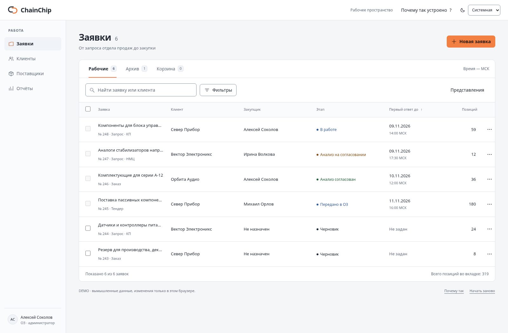
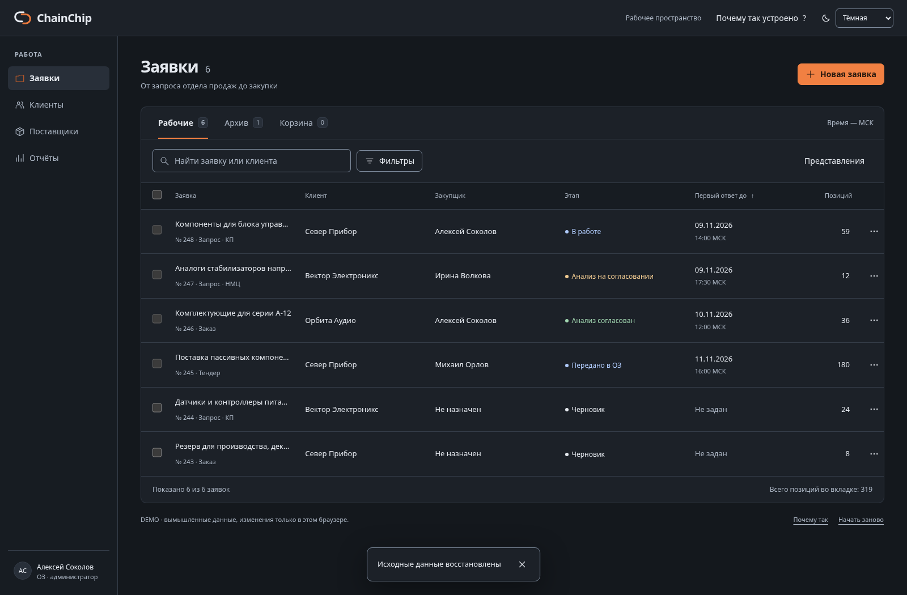
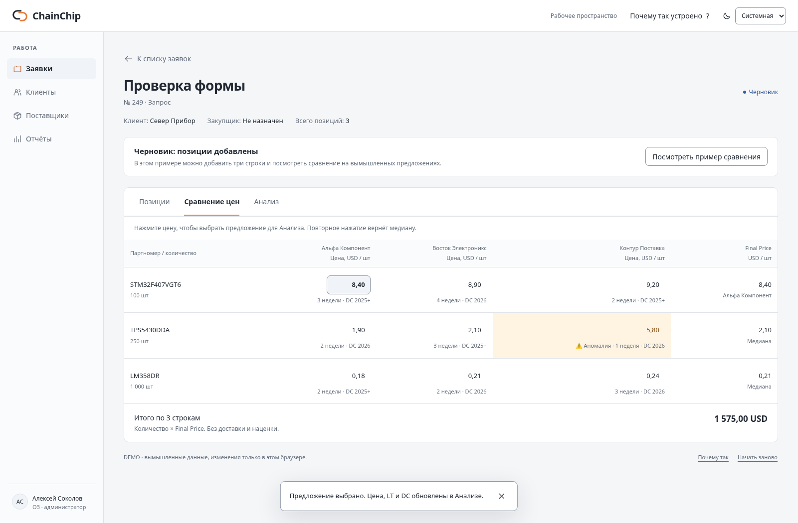
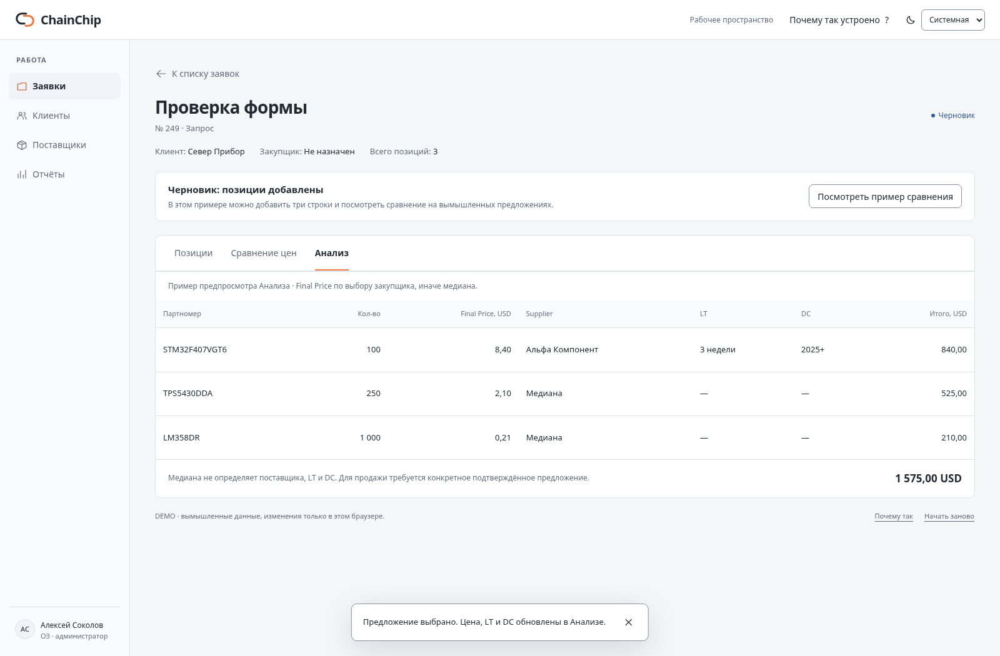

# ChainChip — рабочий интерфейс

**[Открыть страницу](https://b0ttokyanpa.github.io/chainchiprfq/ux-lab/)** · **[Краткая выжимка и источники](RESEARCH.md)** · **[Проверки](VALIDATION.md)**

Отдельный интерактивный пример по результатам обзора 16 открытых материалов о UX/UI. Основное приложение и главная страница проекта не заменены. Данные вымышленные; изменения сохраняются в локальном хранилище браузера.

## Что попробовать

1. Найдите «Север». Откройте фильтры и выберите «Тендер». Снимите фильтр прямо над таблицей.
2. Выделите черновик и назначьте закупщика: таблица не сдвинется. Затем отмените назначение.
3. Через «⋯» переместите заявку в архив. Нажмите «Отменить» в уведомлении.
4. Откройте заявку → «Сравнение цен». Выберите цену первого поставщика → «Анализ»: цена, Supplier, LT и DC обновятся вместе. Повторное нажатие выбранной цены возвращает медиану.
5. Создайте новую заявку с пустыми полями. Исправьте ошибки по ссылкам в сводке. После создания добавьте три примерные позиции.
6. Смените тему. Кнопка «Почему так устроено» объясняет решения и даёт ссылки на первоисточники. На телефоне она находится внизу страницы.

«Начать заново» возвращает исходные записи. Массовое назначение показано только для черновиков. Отчёт исключает корзину и включает архив. В таблице сравнения используются только три примерные строки, область суммы подписана явно. Нет серверной авторизации, реальных документов, продаж и проверки бизнес-прав на API: это отдельный пример поведения интерфейса.

## Снимки









## Открыть без сети

Страница — один HTML-файл без внешних шрифтов, библиотек и аналитики. Откройте [index.html](index.html), нажмите **Download raw file**, сохраните как `ChainChip-UX.html` и откройте двойным щелчком. Если браузер предлагает сохранить текст, выберите тип **«Все файлы»** и имя `ChainChip-UX.html` без `.txt`. Работа localStorage при открытии через `file://` зависит от браузера; при запрете изменения сохранятся только до закрытия страницы.

Также можно скачать [архив](ChainChip-UX.zip) через **Download raw file**, распаковать и открыть `index.html`. Для обычного просмотра проще использовать ссылку «Открыть страницу» сверху.

## Локальная проверка

Из каталога страницы:

```bash
python3 -m http.server 5090 --bind 127.0.0.1
```

В другом терминале, при установленном `playwright-core` и Chromium:

```bash
PLAYWRIGHT_CORE=/путь/к/playwright-core node check.cjs
PLAYWRIGHT_CORE=/путь/к/playwright-core node contrast.cjs
```

Браузерные проверки используют локальный адрес `http://127.0.0.1:5090`. Снимки и отчёт сохраняются рядом со скриптами. Итоги проверки не заменяют исследование с сотрудниками или полный аудит доступности.
